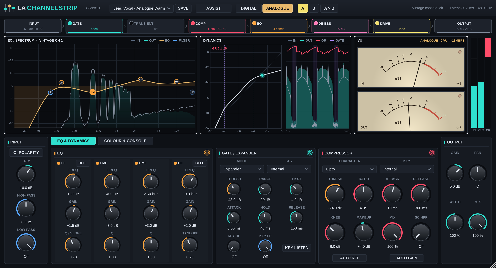
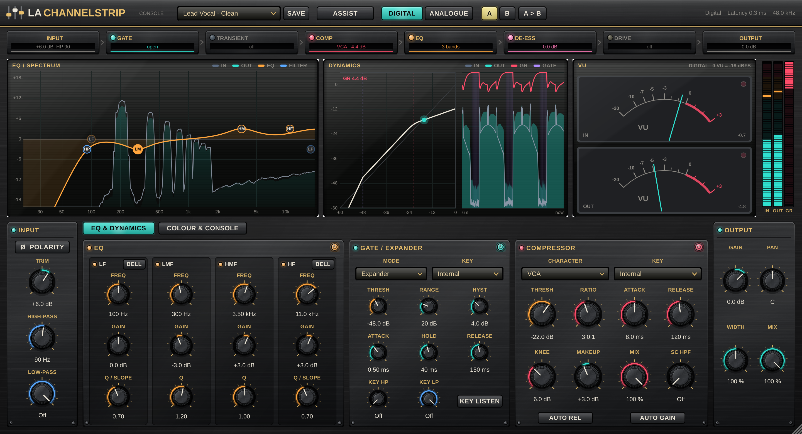
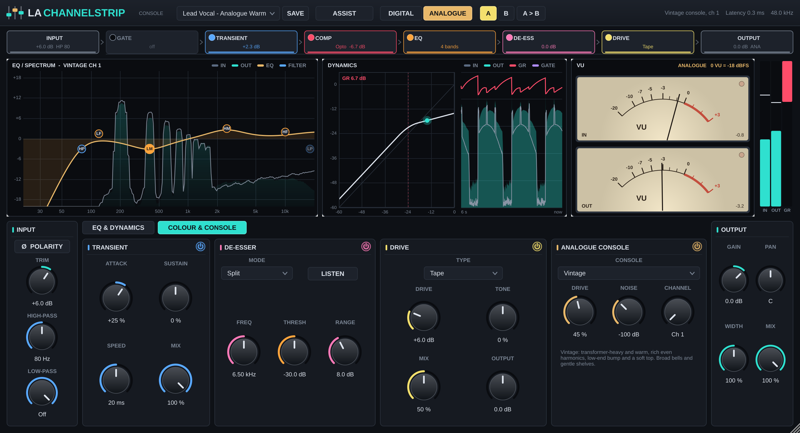

# LA-ChannelStrip

A console channel strip for Linux, Windows and macOS: filters, gate / expander, transient shaper,
compressor with four characters, 4-band EQ, de-esser and drive, with a **Digital / Analogue** switch.
Digital is clean and exact. Analogue gives you the sound of a desk channel: harmonics that grow with level,
the console's EQ curves, feedback compression, per-channel component tolerances and an optional noise floor.
It uses the same look as LA-Trigger, LA-VocalChain, LA-AmpSuite and LA-Master.

| Platform | Formats |
|---|---|
| Windows 10/11 (x64) | VST3 |
| macOS 10.13+ (Apple silicon and Intel) | VST3, AU |
| Linux (x86_64) | VST3, LV2, Standalone |

Ready-to-install builds for all three are on the [Releases](https://github.com/AzoghMartins/LA-ChannelStrip/releases) page.



| Digital mode | Colour & Console page |
|---|---|
|  |  |

## Signal flow

```
INPUT (polarity, trim, console input stage, HP 18 dB/oct, LP 12 dB/oct)
  -> [ GATE  TRANSIENT  COMP  EQ  DE-ESS  DRIVE ] -> console output stage -> OUTPUT (gain, pan, width, mix)
      \______ drag to reorder in the chain strip ______/
```

Each stage is a tile in the chain strip. Click a tile's dot to switch the stage on or off. Click the tile to
open its controls. Drag the module tiles to change their order (for example EQ before or after the compressor).
The order is saved with the session, in presets and in each A/B slot.

## Features

| Stage | What it does |
|---|---|
| **Input** | Polarity invert, trim (±24 dB), an 18 dB/oct high-pass and a 12 dB/oct low-pass. The filters are also the **HP** / **LP** handles on the EQ display. |
| **Gate / Expander** | Gate (closes to the range) or 1:2 expander. Threshold, range, hysteresis (no chattering), attack, hold, release, key high-pass and low-pass, and **KEY LISTEN**. |
| **Transient** | Level-independent transient shaper: attack and sustain (±100 %), speed and mix. Sustain never spills onto the next hit. |
| **Compressor** | **VCA** (clean, precise), **FET** (fast, adds grit), **Opto** (smooth, program-dependent release) and **Vari-Mu** (ratio grows with level). Threshold, ratio 1–20:1, attack, release or **AUTO REL**, knee, makeup or **AUTO GAIN**, mix (parallel), side-chain high-pass. |
| **EQ** | LF and HF shelves (each switchable to a bell), two parametric mids, ±18 dB. Drag the nodes on the display, mouse wheel for Q, double-click to reset. |
| **De-Esser** | Split band (Linkwitz-Riley, only the sibilance band moves) or wide band. Frequency, threshold, range and **LISTEN**. |
| **Drive** | Tape, Tube, Transformer (the low end saturates first) and Transistor, 2x oversampled, level-compensated. Drive, tone, mix and output. |
| **Key routing** | Gate and compressor each listen to **Internal**, **EQ** (the EQ leaves the audio path and shapes the detector, like a desk's "EQ to side-chain") or **External** (the plugin's side-chain input). |
| **Output** | Gain, pan (constant power for mono sources, balance for stereo), width (0–200 %) and a global dry/wet mix. |
| **Digital / Analogue** | See below. |
| **A / B** | Two complete settings slots (with module order). **A > B** copies the current slot to the other. Both are saved with the session. |
| **Assistant** | Press **ASSIST**, play the track for 5–30 seconds, press again. It sets the trim so the channel averages 0 VU (-18 dBFS), and sets the gate (only if there is a clear noise floor), compressor and de-esser thresholds from what it heard. |
| **Displays** | EQ + filter curve over the input / output spectrum. Dynamics: the gate + compressor transfer curve with the live detector level, and a 6 s history of input, output, gain reduction and gate closing. Two VU meters (input after the trim, output) with peak lights; the face lights up in Analogue mode. IN / OUT / GR meters, and live values on every chain tile. |
| **Presets** | 16 factory presets: Lead Vocal - Clean, Lead Vocal - Analogue Warm, Kick - Punch, Snare - Crack, Toms - Gated, Overheads - Air, Bass DI - Solid, Electric Guitar, Acoustic Guitar, Piano - Natural, Podcast / Voice-Over, Synth Bass - Glue, Drums - Parallel Crush, Console Bus - Analogue, Analogue Desk Only, and Default. **SAVE** stores user presets in `~/.config/LA Audio/LA-ChannelStrip/Presets`. |

### Digital and Analogue mode

| | Digital | Analogue |
|---|---|---|
| Harmonics | none | input transformer and line amp stages; they grow with level and with **Drive** (about 0.2 % THD at -18 dBFS by default) |
| EQ curves | exact, constant-Q | the console's: proportional Q (bells narrow as you boost), shelf dips past the corner |
| Filters | Butterworth | slight resonance above the high-pass corner |
| Compressor | feed-forward, exact ratio | feedback detector (softer, program dependent) when the key is internal; FET and Vari-Mu add their colour |
| Tolerances | none | each **Channel** (1–72) has its own small, repeatable errors in EQ frequency / gain / Q, filter corners, thresholds and left/right balance |
| Noise | none | optional noise floor, independent on each side (Off by default) |
| Bandwidth | flat | DC / transformer high-pass, low-end bump and a soft top, depending on the console |

The three consoles:

- **British**: crisp, mostly odd harmonics, proportional-Q bells, resonant high-pass.
- **American**: punchy, 2nd harmonic forward, a little low-end weight, strong proportional Q and deeper shelf dips.
- **Vintage**: transformer-heavy and warm, rich even harmonics, low-end bump and a soft top, broad bells.

Switching modes does not change the latency, so you can A/B them freely.

### Compared with other channel strips

The feature set was checked against SSL Native Channel Strip 2, the bx_console series, UAD API Vision Channel
Strip and Softube Console 1:

| Feature | Covered by |
|---|---|
| HP / LP filters, 4-band EQ with shelf / bell switches (SSL, API) | Input filters + EQ |
| E / G style EQ characters (SSL) | Analogue consoles (British, American, Vintage); Digital |
| Compressor + gate / expander with independent side-chains (SSL, API) | Gate / Expander, Compressor |
| Gate hysteresis (bx_console) | Gate **Hyst** |
| EQ to the dynamics side-chain (API "DYN SC", SSL) | Key: **EQ** |
| External side-chain input (SSL) | Key: **External** |
| Variable process order (SSL) | Drag the chain tiles |
| Feedback / feed-forward compression ("Old" / "New", API 225L) | Analogue (feedback) / Digital (feed-forward) |
| THD, noise and channel tolerances (bx_console TMT, V-Gain) | Console Drive, Noise, Channel 1–72 |
| Drive / saturation before the EQ (Console 1) | Drive (any position in the chain) |
| Transient shaping (Console 1 "Shape") | Transient |
| Output fader, pan, width (SSL v2) | Output |
| De-esser, parallel mix | De-Esser, compressor Mix and global Mix |

Not included: modelled preamp gain staging with mic / line inputs, the API 560 graphic EQ, and console-wide
features that need several instances to talk to each other (group VCA, "randomise all channels").

### Latency

Constant at 0.3 ms (15 samples at 48 kHz), from the Drive's 2x oversampling. It does not change with the mode
or the settings and is reported to the host.

## Building

### Linux

```bash
sudo apt install build-essential cmake ninja-build libasound2-dev libx11-dev libxrandr-dev \
  libxinerama-dev libxcursor-dev libxext-dev libfreetype-dev libfontconfig1-dev libgl1-mesa-dev

cmake -B build -G Ninja -DCMAKE_BUILD_TYPE=Release        # downloads JUCE 8 automatically
cmake --build build -j
xvfb-run -a ctest --test-dir build --output-on-failure    # optional: run the tests

# install
mkdir -p ~/.vst3 ~/.lv2
cp -r build/LAChannelStrip_artefacts/Release/VST3/LA-ChannelStrip.vst3 ~/.vst3/
cp -r build/LAChannelStrip_artefacts/Release/LV2/LA-ChannelStrip.lv2 ~/.lv2/
```

Options:
- `-DLACS_JUCE_DIR=/path/to/JUCE` uses a local JUCE checkout.
- `-DLACS_COPY_AFTER_BUILD=ON` installs the plugins automatically.
- `-DLACS_ENGINE_ONLY=ON` builds only the DSP engine and its tests (no JUCE needed).

To use the external key, enable the plugin's side-chain input in your host and route a track to it.

### Windows

Needs Visual Studio 2022 (the "Desktop development with C++" workload) and CMake 3.22 or newer.

```powershell
cmake -B build -G "Visual Studio 17 2022" -A x64          # downloads JUCE 8 automatically
cmake --build build --config Release --parallel
ctest --test-dir build -C Release --output-on-failure       # optional: run the tests
```

Install by copying `build\LAChannelStrip_artefacts\Release\VST3\LA-ChannelStrip.vst3` into `C:\Program Files\Common Files\VST3`.

### macOS

Needs Xcode (or the Command Line Tools) and CMake 3.22 or newer. The build is a universal binary
(Apple silicon and Intel) and runs on macOS 10.13 or newer.

```bash
cmake -B build -DCMAKE_BUILD_TYPE=Release                   # downloads JUCE 8 automatically
cmake --build build --parallel
ctest --test-dir build --output-on-failure                  # optional: run the tests

# install
cp -R build/LAChannelStrip_artefacts/Release/VST3/LA-ChannelStrip.vst3 ~/Library/Audio/Plug-Ins/VST3/
cp -R build/LAChannelStrip_artefacts/Release/AU/LA-ChannelStrip.component ~/Library/Audio/Plug-Ins/Components/
```

### Downloads

GitHub Actions builds every push on Linux, Windows and macOS and uploads ready-to-install archives as
artifacts. Tagged releases carry all three:

- `LA-ChannelStrip-linux-x86_64.tar.gz`: VST3, LV2 and Standalone. Copy them into `~/.vst3` and `~/.lv2`.
- `LA-ChannelStrip-windows-x64.zip`: VST3. Extract it into `C:\Program Files\Common Files\VST3`.
- `LA-ChannelStrip-macos-universal.zip`: VST3 and AU. Copy them into `~/Library/Audio/Plug-Ins/VST3` and
  `~/Library/Audio/Plug-Ins/Components`. The plugins are not notarized, so after downloading, clear the
  quarantine flag once before starting your DAW:
  `xattr -dr com.apple.quarantine ~/Library/Audio/Plug-Ins/VST3/LA-ChannelStrip.vst3 ~/Library/Audio/Plug-Ins/Components/LA-ChannelStrip.component`

## Project layout

```
Source/dsp/Modules.*        console stages and tolerances, filters, EQ, gate, compressor, de-esser, transient shaper, drive
Source/dsp/StripEngine.*    the chain, module order, key routing, output stage, metering, assistant analysis (no JUCE dependency)
Source/Parameters.*         70 parameters and the factory presets
Source/PluginProcessor.*    JUCE processor: buses (incl. side-chain), A/B slots, assistant, presets, state
Source/gui/                 look and feel, knobs, chain strip, EQ / dynamics / VU displays, editor
tests/EngineTests.cpp       45 DSP tests (transparency, harmonics, tolerances, filter slopes, EQ curves, gate, compressor ratios,
                            side-chains, de-esser, transients, drive, order, assistant, random settings, speed)
tests/PluginIntegrationTest  drives processor + editor like a host; can render a screenshot:
                            lacs_integration out.png [page 0|1] [analogue 0|1]
```

## License

LA-ChannelStrip is free software: you can redistribute it and/or modify it under the terms of the
[GNU Affero General Public License, version 3](LICENSE) (AGPL-3.0). It comes with absolutely no warranty.
This applies to every release, including v0.1 and v0.2, which were published before the LICENSE file was added.

Copyright (C) 2026 AzoghMartins (Lantern Assembly).

LA-ChannelStrip is built on [JUCE 8](https://juce.com), used here under the AGPLv3.
